# Indian Sign Language (ISL) reference

This is every sign the [Sign language](sign-language.md) section recognises, with a picture and a short
description of how it is made. **Nothing here is drawn or written by hand:** for each sign, the most typical recording
in the training data (the one closest to the average of all recordings of that sign) is drawn as a skeleton, and the
description is measured from the same recording: how many hands, the hand shape (which fingers are straight), where the
sign is made, which way the hand moves, and whether the movement repeats.

**Reading the pictures.** You see the signer facing you, as on a video call, so the signer's **right hand (blue)** is on
the **left** of the picture and the left hand (orange) on the right. A grey hand is resting. Word signs show the start,
middle and end of the movement, with the path of each wrist dashed on the middle figure and an arrow at its end.
Letters and numbers show the whole person and, beside it, an enlarged view of the hands.

**Accuracy** is how often the app recognised that sign correctly in recordings it was not trained on (words: INCLUDE's
test videos; letters and numbers: adult signers, while training used kids and teenagers). A blank means too few test
recordings.

**Learning ISL.** These pictures are a reminder, not a course. To learn signs properly, use the video dictionary of the
[Indian Sign Language Research and Training Centre (ISLRTC)](https://islrtc.nic.in/) and learn from Deaf signers.
Signs vary between regions; the word signs here were recorded in Chennai.

Sources: words from **INCLUDE** (Sridhar, Ganesan, Kumar, Khapra; AI4Bharat and IIT Madras; ACM Multimedia 2020),
[zenodo.org/records/4010759](https://zenodo.org/records/4010759), CC BY 4.0. Letters and numbers from **Static gestures
of Indian Sign Language (ISL) for English Alphabet, Hindi Vowels and Numerals**, Mendeley Data,
[doi 10.17632/7tsw22y96w.1](https://data.mendeley.com/datasets/7tsw22y96w), CC BY 4.0. The pictures and descriptions
are derived from these datasets (landmarks only) and are shared under the same licence.

## Contents

- [Overview and accuracy](#overview-and-accuracy)
- [Fingerspelling: letters A to Z](#fingerspelling:-letters-a-to-z)
- [Numbers 0 to 9](#numbers-0-to-9)
- [Greetings and everyday expressions](#greetings-and-everyday-expressions)
- [Pronouns](#pronouns)
- [People and family](#people-and-family)
- [Days and time](#days-and-time)
- [Places](#places)
- [Society](#society)
- [Questions](#questions)
- [Phrases and sentences](#phrases-and-sentences)
- [Signs that look alike](#signs-that-look-alike)
- [What is not supported yet](#what-is-not-supported-yet)

## Overview and accuracy

| | Signs | Correct on first guess | Right answer in top 3 | When it answers |
|---|---|---|---|---|
| Words | 106 | 87 % of 335 test videos | 94 % | answers 84 % of the time, and is right 94 % of those times |
| Letters and numbers | 36 | 81 % of 2055 single images of unseen signers | 95 % | single images: answers 43 %, right 95 %; live, letters are held for half a second, which makes it answer far more often |

When it is not sure, the app says so and shows its best three guesses instead of writing a wrong word.

## Fingerspelling: letters A to Z

ISL fingerspelling mostly uses **both hands**. Hold each letter still for about half a second; lower your hands to end a word. E has two common forms in the dataset; both are recognised. H, J and Y involve movement, but the dataset records their final position, which is what the app recognises.

| Sign | Picture | How it is made | Accuracy |
|---|---|---|---|
| **A** | 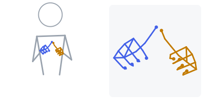 | Two hands. Right hand: thumb and index and middle and ring extended, at chest level. Left hand: fist with the thumb out, at waist level. | 84 % |
| **B** | 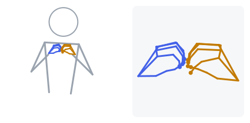 | Two hands. Right hand: closed fist, at chest level. Left hand: little finger raised, at chest level. | 100 % |
| **C** | 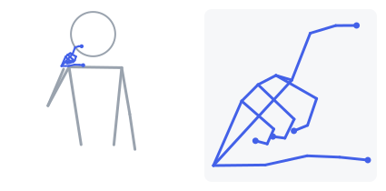 | One hand. Right hand: L shape (thumb and index), at chest level. | 75 % |
| **D** | 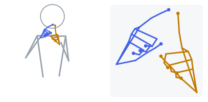 | Two hands. Right hand: index finger pointing, at chest level. Left hand: index finger pointing, at chest level. | 42 % |
| **E** | 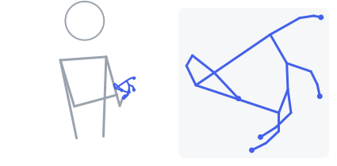 | One hand. Right hand: index finger pointing, at waist level. | 66 % |
| **F** | 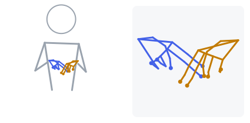 | Two hands. Right hand: thumb and index and middle extended, at chest level. Left hand: thumb and index and middle extended, at chest level. | 85 % |
| **G** | 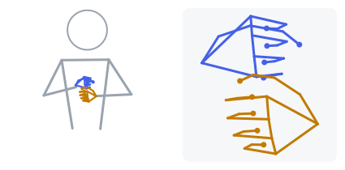 | Two hands. Right hand: fist with the thumb out, at chest level. Left hand: fist with the thumb out, at waist level. | 86 % |
| **H** | 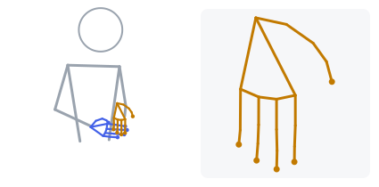 | One hand. Left hand: flat hand, thumb folded, at waist level. | 78 % |
| **I** | 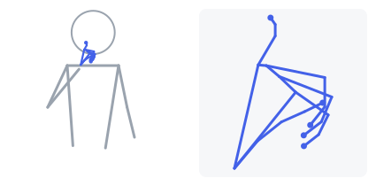 | One hand. Right hand: index finger pointing, at chest level. | 84 % |
| **J** | 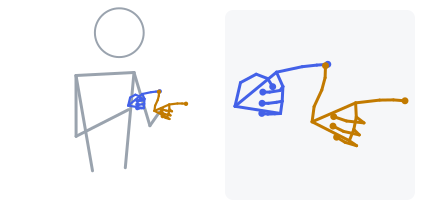 | Two hands. Right hand: index finger pointing, at chest level. Left hand: L shape (thumb and index), at waist level. | 90 % |
| **K** | 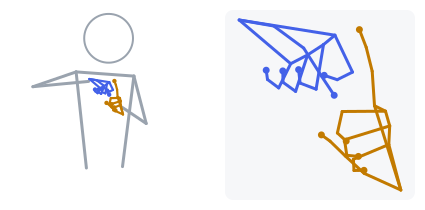 | Two hands. Right hand: fist with the thumb out, at chest level. Left hand: index finger pointing, at waist level. | 90 % |
| **L** | 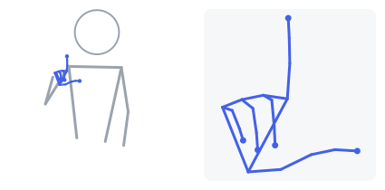 | One hand. Right hand: L shape (thumb and index), at chest level. | 78 % |
| **M** | 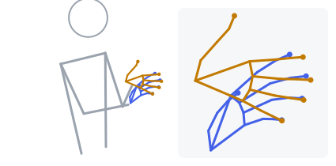 | Two hands. Right hand: flat hand, thumb folded, at waist level. Left hand: open flat hand, at chest level. The hands touch or overlap. | 50 % |
| **N** | 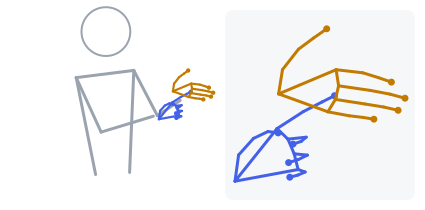 | Two hands. Right hand: index finger pointing, at waist level. Left hand: flat hand, thumb folded, at chest level. | 59 % |
| **O** | 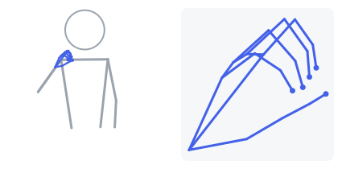 | One hand. Right hand: closed fist, at chest level. | 56 % |
| **P** | 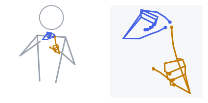 | Two hands. Right hand: index finger pointing, at chest level. Left hand: L shape (thumb and index), at waist level. | 100 % |
| **Q** | 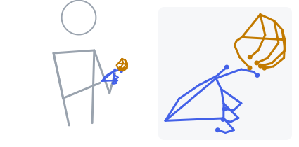 | Two hands. Right hand: L shape (thumb and index), at waist level. Left hand: closed fist, at chest level. | 95 % |
| **R** | 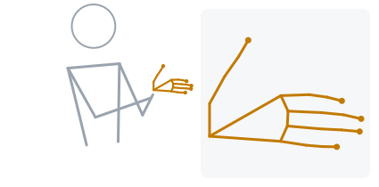 | One hand. Left hand: flat hand, thumb folded, at chest level. | 92 % |
| **S** | 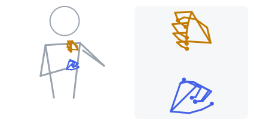 | Two hands. Right hand: closed fist, at waist level. Left hand: fist with the thumb out, at chest level. | 89 % |
| **T** | 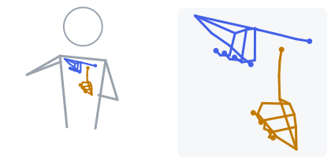 | Two hands. Right hand: index finger pointing, at chest level. Left hand: index finger pointing, at waist level. | 38 % |
| **U** | 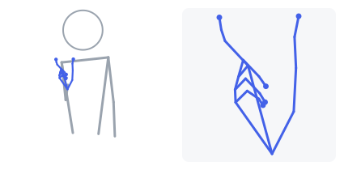 | One hand. Right hand: L shape (thumb and index), at waist level. | 78 % |
| **V** | 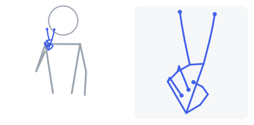 | One hand. Right hand: index and middle finger (V), at chest level. | 73 % |
| **W** | 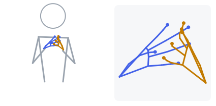 | Two hands. Right hand: flat hand, thumb folded, at chest level. Left hand: open flat hand, at chest level. | 93 % |
| **X** | 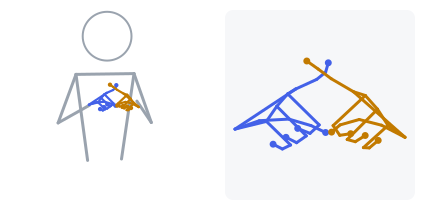 | Two hands. Right hand: L shape (thumb and index), at chest level. Left hand: L shape (thumb and index), at waist level. | 47 % |
| **Y** | 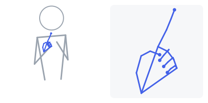 | One hand. Right hand: index finger pointing, at chest level. | 81 % |
| **Z** | 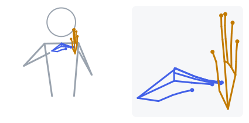 | Two hands. Right hand: flat hand, thumb folded, at chest level. Left hand: open flat hand, at chest level. | 96 % |

## Numbers 0 to 9

Numbers are mostly one hand. **0 and the letter O share one hand shape**: the app writes 0 after another digit and O otherwise. 9 has two common forms in the dataset; both are recognised.

| Sign | Picture | How it is made | Accuracy |
|---|---|---|---|
| **0** | 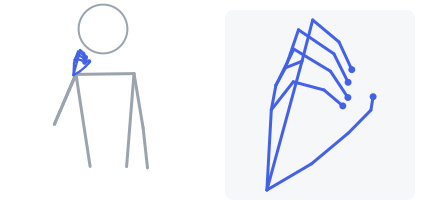 | One hand. Right hand: closed fist, at chest level. | 63 % |
| **1** | 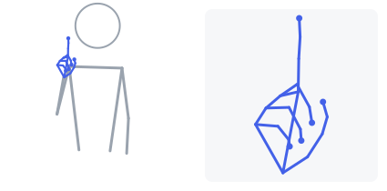 | One hand. Right hand: index finger pointing, at chest level. | 90 % |
| **2** | 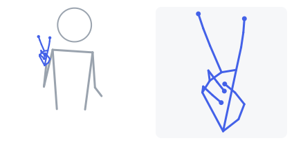 | One hand. Right hand: index and middle finger (V), at chest level. | 89 % |
| **3** | 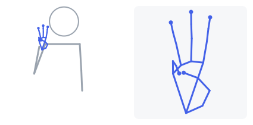 | One hand. Right hand: index and middle and ring extended, at chest level. | 96 % |
| **4** | 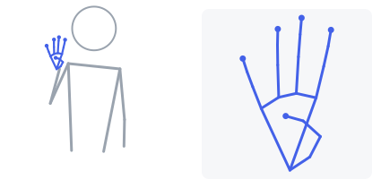 | One hand. Right hand: flat hand, thumb folded, at chest level. | 100 % |
| **5** | 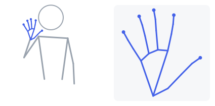 | One hand. Right hand: open flat hand, at chest level. | 100 % |
| **6** | 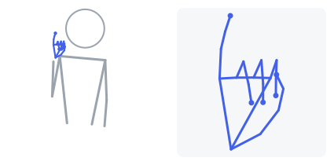 | One hand. Right hand: little finger raised, at chest level. | 100 % |
| **7** | 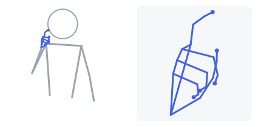 | One hand. Right hand: index finger pointing, at chest level. | 94 % |
| **8** | 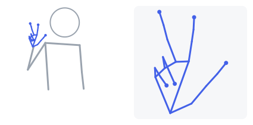 | One hand. Right hand: thumb and index and middle extended, at chest level. | 81 % |
| **9** | 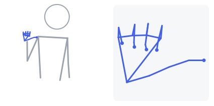 | One hand. Right hand: fist with the thumb out, at chest level. | 100 % |

## Greetings and everyday expressions

| Sign | Picture | How it is made | Accuracy |
|---|---|---|---|
| **Alright** | 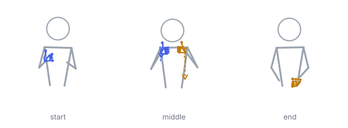 | Two hands. Right hand: thumb and little finger out (Y), at chest level, moves and comes back. Left hand: fist with the thumb out, at chest level, moves downwards. | 75 % |
| **Good afternoon** | 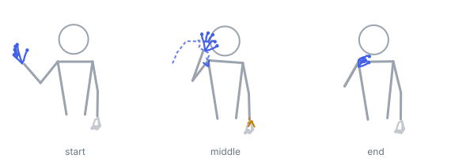 | One hand (the signer's right); the other hand rests. Right hand: flat hand, thumb folded, at chest level, moves towards the signer's left. | 100 % |
| **Good evening** | 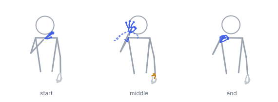 | One hand (the signer's right); the other hand rests. Right hand: flat hand, thumb folded, at chest level, moves towards the signer's right, repeated. | 57 % |
| **Good Morning** | 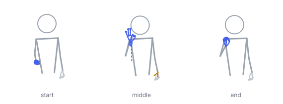 | One hand (the signer's right); the other hand rests. Right hand: middle and ring and little extended, at chest level, moves upwards. | 100 % |
| **Good night** | 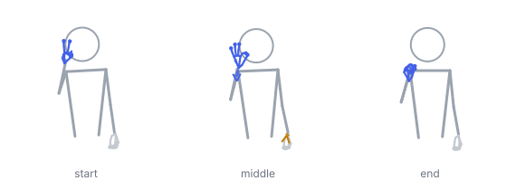 | One hand (the signer's right); the other hand rests. Right hand: thumb and middle and ring and little extended, at chest level, moves downwards. | 75 % |
| **Hello** | 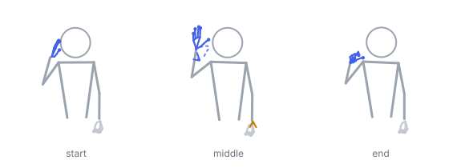 | One hand (the signer's right); the other hand rests. Right hand: open flat hand, at chest level, moves and comes back. | 100 % |
| **How are you** | 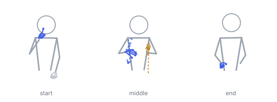 | Two hands. Right hand: open flat hand, at chest level, moves downwards, repeated. Left hand: thumb and middle and ring and little extended, at chest level, moves and comes back, repeated. | 100 % |
| **Pleased** | 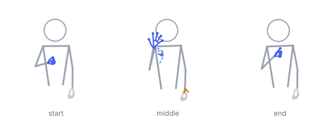 | One hand (the signer's right); the other hand rests. Right hand: open flat hand, at chest level, moves upwards. | 100 % |
| **Thank you** | 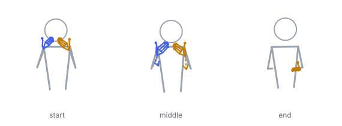 | Two hands. Right hand: open flat hand, at chest level, moves downwards. Left hand: open flat hand, at chest level, moves downwards. | 100 % |

## Pronouns

| Sign | Picture | How it is made | Accuracy |
|---|---|---|---|
| **he** | 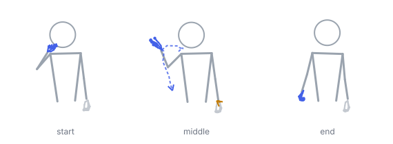 | One hand (the signer's right); the other hand rests. Right hand: open flat hand, at chest level, moves downwards. | 75 % |
| **I** | 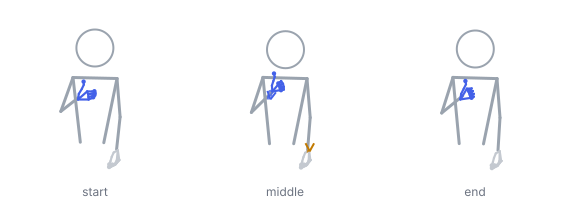 | One hand (the signer's right); the other hand rests. Right hand: fist with the thumb out, at chest level, stays in place. | 100 % |
| **it** | 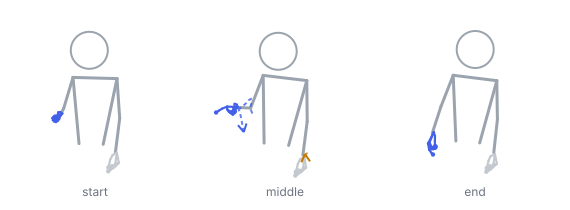 | One hand (the signer's right); the other hand rests. Right hand: index finger pointing, at waist level, moves downwards. | 100 % |
| **she** | 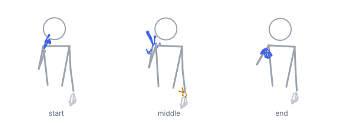 | One hand (the signer's right); the other hand rests. Right hand: open flat hand, at chest level, moves towards the signer's right. | 75 % |
| **they** | 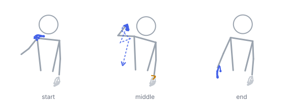 | One hand (the signer's right); the other hand rests. Right hand: open flat hand, near the face, moves towards the signer's right and downwards, repeated. | 100 % |
| **we** |  | Two hands. Right hand: flat hand, thumb folded, at chest level, moves towards the signer's left and downwards. Left hand: thumb and ring and little extended, at chest level, moves towards the signer's right and upwards. | 50 % |
| **you** |  | One hand (the signer's right); the other hand rests. Right hand: L shape (thumb and index), at chest level, stays in place. | 100 % |
| **you (plural)** |  | One hand (the signer's right); the other hand rests. Right hand: index finger pointing, at chest level, moves towards the signer's right. | 100 % |

## People and family

| Sign | Picture | How it is made | Accuracy |
|---|---|---|---|
| **Adult** |  | One hand (the signer's right); the other hand rests. Right hand: index and middle finger (V), at chest level, moves towards the signer's right and upwards. | 100 % |
| **Baby** |  | Two hands. Right hand: open flat hand, at chest level, moves and comes back. Left hand: flat hand, thumb folded, at waist level, moves and comes back. | 50 % |
| **Boy** |  | One hand (the signer's right); the other hand rests. Right hand: flat hand, thumb folded, at chest level, moves towards the signer's right. | 75 % |
| **Brother** |  | One hand (the signer's right); the other hand rests. Right hand: open flat hand, at chest level, moves towards the signer's left. | 75 % |
| **Child** |  | One hand (the signer's right); the other hand rests. Right hand: closed fist, at chest level, stays in place. | 75 % |
| **Crowd** |  | Two hands. Right hand: open flat hand, at chest level, stays in place. Left hand: thumb and index and middle extended, at chest level, moves and comes back. | 100 % |
| **Daughter** |  | One hand (the signer's right); the other hand rests. Right hand: open flat hand, at chest level, moves downwards. | 75 % |
| **Family** |  | Two hands. Right hand: index and middle finger (V), at waist level, moves and comes back. Left hand: index and middle finger (V), at waist level, moves and comes back. | 100 % |
| **Father** |  | Two hands. Right hand: index and middle finger (V), at chest level, moves downwards. Left hand: index and middle finger (V), at chest level, moves upwards. | 50 % |
| **Friend** |  | One hand (the signer's right); the other hand rests. Right hand: thumb and index and middle and ring extended, at chest level, stays in place. | 67 % |
| **Girl** |  | One hand (the signer's right); the other hand rests. Right hand: index finger pointing, at chest level, moves towards the signer's right and downwards. | 100 % |
| **Grandfather** |  | Two hands. Right hand: open flat hand, at chest level, moves downwards, repeated. Left hand: closed fist, at waist level, moves towards the signer's right. | 100 % |
| **Grandmother** |  | One hand (the signer's right); the other hand rests. Right hand: open flat hand, at chest level, moves downwards. | 100 % |
| **Husband** |  | Two hands. Right hand: flat hand, thumb folded, at chest level, moves downwards. Left hand: flat hand, thumb folded, at chest level, stays in place. | 100 % |
| **King** |  | One hand (the signer's right); the other hand rests. Right hand: flat hand, thumb folded, near the face, moves upwards. | 100 % |
| **Man** |  | One hand (the signer's right); the other hand rests. Right hand: closed fist, at chest level, moves and comes back. | 100 % |
| **Mother** |  | One hand (the signer's right); the other hand rests. Right hand: closed fist, at chest level, stays in place. | 100 % |
| **Neighbour** |  | Two hands. Right hand: open flat hand, at chest level, moves downwards. Left hand: open flat hand, at chest level, moves downwards. | 75 % |
| **Parent** |  | One hand (the signer's right); the other hand rests. Right hand: open flat hand, at chest level, moves and comes back. | 100 % |
| **Player** |  | One hand (the signer's right); the other hand rests. Right hand: L shape (thumb and index), at chest level, moves and comes back. | 100 % |
| **President** |  | Two hands. Right hand: fist with the thumb out, at chest level, moves towards the signer's left and downwards. Left hand: open flat hand, at chest level, moves and comes back. | 100 % |
| **Queen** |  | One hand (the signer's right); the other hand rests. Right hand: flat hand, thumb folded, near the face, moves upwards. | 100 % |
| **Sister** |  | One hand (the signer's right); the other hand rests. Right hand: open flat hand, at chest level, moves towards the signer's left and downwards. | 50 % |
| **Son** |  | Two hands. Right hand: flat hand, thumb folded, at chest level, moves downwards. Left hand: flat hand, thumb folded, at waist level, stays in place. | 100 % |
| **Wife** |  | Two hands. Right hand: flat hand, thumb folded, at chest level, moves downwards. Left hand: open flat hand, at chest level, stays in place. | 25 % |
| **Woman** |  | One hand (the signer's right); the other hand rests. Right hand: index finger pointing, at chest level, stays in place. | 100 % |

## Days and time

| Sign | Picture | How it is made | Accuracy |
|---|---|---|---|
| **Afternoon** |  | One hand (the signer's right); the other hand rests. Right hand: open flat hand, near the face, moves and comes back. | 100 % |
| **Evening** |  | One hand (the signer's right); the other hand rests. Right hand: index and middle and ring extended, at chest level, moves towards the signer's right. | 0 % |
| **Friday** |  | One hand (the signer's right); the other hand rests. Right hand: closed fist, at chest level, stays in place. | 100 % |
| **Hour** |  | Two hands. Right hand: fist with the thumb out, at chest level, moves towards the signer's right and downwards. Left hand: closed fist, at waist level, moves and comes back. | 100 % |
| **Minute** |  | One hand (the signer's right); the other hand rests. Right hand: L shape (thumb and index), at chest level, stays in place. | 100 % |
| **Monday** |  | One hand (the signer's right); the other hand rests. Right hand: open flat hand, at chest level, moves and comes back. | 0 % |
| **Month** |  | Two hands. Right hand: fist with the thumb out, at chest level, moves and comes back. Left hand: open flat hand, at chest level, stays in place. | 100 % |
| **Morning** |  | One hand (the signer's right); the other hand rests. Right hand: open flat hand, at chest level, moves and comes back. | 100 % |
| **Night** |  | One hand (the signer's right); the other hand rests. Right hand: open flat hand, at chest level, stays in place. | 100 % |
| **Saturday** |  | One hand (the signer's right); the other hand rests. Right hand: thumb and index and middle extended, at chest level, moves and comes back. | 100 % |
| **Second** |  | One hand (the signer's right); the other hand rests. Right hand: index finger pointing, at chest level, stays in place. | 100 % |
| **Sunday** |  | One hand (the signer's right); the other hand rests. Right hand: fist with the thumb out, at chest level, stays in place. | 100 % |
| **Thursday** |  | One hand (the signer's right); the other hand rests. Right hand: L shape (thumb and index), at chest level, moves and comes back. | 0 % |
| **Time** |  | Two hands. Right hand: index finger pointing, at chest level, stays in place. Left hand: closed fist, at chest level, moves upwards. | 100 % |
| **Today** |  | One hand (the signer's right); the other hand rests. Right hand: open flat hand, at chest level, moves downwards. |  |
| **Tomorrow** |  | One hand (the signer's right); the other hand rests. Right hand: closed fist, at chest level, moves downwards. | 100 % |
| **Tuesday** |  | One hand (the signer's right); the other hand rests. Right hand: closed fist, at chest level, moves and comes back. | 100 % |
| **Wednesday** |  | Two hands. Right hand: open flat hand, at chest level, moves upwards. Left hand: open flat hand, at chest level, moves and comes back. | 100 % |
| **Week** |  | Two hands. Right hand: flat hand, thumb folded, at chest level, moves and comes back. Left hand: open flat hand, at chest level, stays in place. | 100 % |
| **Year** |  | Two hands. Right hand: thumb and middle and ring and little extended, at chest level, moves downwards. Left hand: flat hand, thumb folded, at chest level, moves and comes back. | 100 % |
| **Yesterday** |  | One hand (the signer's right); the other hand rests. Right hand: index finger pointing, at chest level, moves and comes back. | 100 % |

## Places

| Sign | Picture | How it is made | Accuracy |
|---|---|---|---|
| **Bank** |  | One hand (the signer's right); the other hand rests. Right hand: open flat hand, at chest level, moves and comes back. | 100 % |
| **City** |  | One hand (the signer's right); the other hand rests. Right hand: middle and ring and little extended, at chest level, moves and comes back. | 100 % |
| **Court** |  | Two hands. Right hand: thumb and index and middle extended, at chest level, moves and comes back. Left hand: thumb and index and middle extended, at chest level, moves downwards. | 100 % |
| **Ground** |  | Two hands. Right hand: index and middle finger (V), at chest level, moves and comes back. Left hand: thumb and index and middle extended, at chest level, moves and comes back. | 100 % |
| **Hospital** |  | One hand (the signer's right); the other hand rests. Right hand: open flat hand, at chest level, moves towards the signer's right and upwards. | 100 % |
| **House** |  | Two hands. Right hand: open flat hand, at chest level, moves towards the signer's right and downwards. Left hand: open flat hand, at chest level, moves and comes back. | 75 % |
| **India** |  | One hand (the signer's right); the other hand rests. Right hand: closed fist, near the face, moves upwards. | 100 % |
| **Library** |  | One hand (the signer's right); the other hand rests. Right hand: flat hand, thumb folded, at chest level, moves and comes back, repeated. | 25 % |
| **Location** |  | One hand (the signer's right); the other hand rests. Right hand: thumb and index and little extended, at chest level, moves and comes back. | 100 % |
| **Market** |  | Two hands. Right hand: thumb and index and middle and ring extended, at chest level, moves and comes back. Left hand: open flat hand, at chest level, moves and comes back. | 67 % |
| **Office** |  | One hand (the signer's right); the other hand rests. Right hand: middle and ring and little extended, at chest level, moves and comes back. | 100 % |
| **Park** |  | Two hands. Right hand: L shape (thumb and index), at chest level, moves and comes back, repeated. Left hand: L shape (thumb and index), at chest level, moves downwards. | 100 % |
| **Restaurant** |  | One hand (the signer's right); the other hand rests. Right hand: thumb and ring and little extended, at chest level, stays in place. | 75 % |
| **School** |  | Two hands. Right hand: open flat hand, at chest level, moves upwards. Left hand: open flat hand, at chest level, moves and comes back. | 100 % |
| **Store or Shop** |  | One hand (the signer's right); the other hand rests. Right hand: flat hand, thumb folded, at waist level, stays in place. | 50 % |
| **Street or Road** |  | One hand (the signer's left); the other hand rests. Left hand: index finger pointing, at waist level, moves and comes back. | 50 % |
| **Temple** |  | Two hands. Right hand: fist with the thumb out, at chest level, moves towards the signer's right and downwards. Left hand: closed fist, at chest level, moves upwards. | 100 % |
| **Train Station** |  | Two hands. Right hand: open flat hand, at chest level, moves towards the signer's right and downwards, repeated. Left hand: index finger pointing, at waist level, moves downwards. | 75 % |
| **University** |  | One hand (the signer's right); the other hand rests. Right hand: L shape (thumb and index), at chest level, moves and comes back. | 75 % |

## Society

| Sign | Picture | How it is made | Accuracy |
|---|---|---|---|
| **Attack** |  | One hand (the signer's right); the other hand rests. Right hand: index finger pointing, at chest level, moves towards the signer's left and upwards. | 100 % |
| **Ball** |  | One hand (the signer's right); the other hand rests. Right hand: open flat hand, at chest level, stays in place. | 100 % |
| **Bill** |  | Two hands. Right hand: flat hand, thumb folded, at chest level, moves downwards. Left hand: flat hand, thumb folded, at chest level, moves downwards. | 0 % |
| **Death** |  | Two hands. Right hand: open flat hand, at chest level, moves towards the signer's right and downwards, repeated. Left hand: open flat hand, at chest level, moves towards the signer's right. | 67 % |
| **Election** |  | Two hands. Right hand: open flat hand, at chest level, moves downwards, repeated. Left hand: open flat hand, at chest level, moves and comes back. | 100 % |
| **Energy** |  | Two hands. Right hand: closed fist, at chest level, stays in place. Left hand: closed fist, at chest level, moves downwards. | 100 % |
| **Exercise** |  | Two hands. Right hand: closed fist, at chest level, moves and comes back, repeated. Left hand: closed fist, at chest level, moves towards the signer's right. | 100 % |
| **God** |  | Two hands. Right hand: fist with the thumb out, at chest level, moves and comes back. Left hand: fist with the thumb out, at chest level, moves towards the signer's left and downwards. | 100 % |
| **Gun** |  | One hand (the signer's right); the other hand rests. Right hand: thumb and index and middle extended, at chest level, stays in place. | 100 % |
| **Marriage** |  | Two hands. Right hand: flat hand, thumb folded, at chest level, moves downwards. Left hand: flat hand, thumb folded, at chest level, moves downwards. | 67 % |
| **Medicine** |  | Two hands. Right hand: thumb and index and middle extended, at chest level, moves towards the signer's right and downwards. Left hand: index and ring and little extended, at chest level, moves towards the signer's left. | 100 % |
| **Money** |  | One hand (the signer's right); the other hand rests. Right hand: fist with the thumb out, at chest level, stays in place. | 100 % |
| **Newspaper** |  | Two hands. Right hand: open flat hand, at chest level, moves and comes back. Left hand: index and middle finger (V), at chest level, moves towards the signer's left. | 100 % |
| **Peace** |  | Two hands. Right hand: open flat hand, at chest level, moves downwards. Left hand: open flat hand, at chest level, moves towards the signer's left. | 100 % |
| **Price** |  | One hand (the signer's right); the other hand rests. Right hand: closed fist, at chest level, moves towards the signer's right and downwards. | 100 % |
| **Race (ethnicity)** |  | Two hands. Right hand: fist with the thumb out, at chest level, moves and comes back, repeated. Left hand: fist with the thumb out, at chest level, moves downwards, repeated. | 33 % |
| **Religion** |  | One hand (the signer's right); the other hand rests. Right hand: flat hand, thumb folded, at chest level, moves towards the signer's right and downwards. | 100 % |
| **Science** |  | Two hands. Right hand: fist with the thumb out, at chest level, moves downwards, repeated. Left hand: index finger pointing, at chest level, moves towards the signer's left and downwards, repeated. | 100 % |
| **Sign** |  | One hand (the signer's right); the other hand rests. Right hand: L shape (thumb and index), at chest level, moves towards the signer's right and downwards, repeated. | 100 % |
| **Sport** |  | Two hands. Right hand: index and middle finger (V), at chest level, moves towards the signer's right and downwards, repeated. Left hand: thumb and index and middle extended, at chest level, moves towards the signer's left and downwards, repeated. | 100 % |
| **Team** |  | Two hands. Right hand: closed fist, at chest level, moves and comes back. Left hand: index finger pointing, at chest level, moves upwards. | 100 % |
| **Technology** |  | Two hands. Right hand: open flat hand, at chest level, moves and comes back. Left hand: open flat hand, at chest level, stays in place. | 100 % |
| **War** |  | Two hands. Right hand: flat hand, thumb folded, at chest level, moves towards the signer's left. Left hand: flat hand, thumb folded, at chest level, moves towards the signer's right. | 100 % |

## Questions

The vocabulary has one question sign, **HOW ARE YOU** (see Greetings). In ISL, questions are mostly marked with the face
(raised or lowered eyebrows) and with question signs such as WHAT, WHERE and WHY. The app does not read facial expressions
and these question signs are not in the trained vocabulary yet, so it cannot tell a question from a statement. A question
mark is not added automatically.

## Phrases and sentences

The app recognises **one sign at a time** and writes the signs in the order they were made (ISL gloss order). You can sign
these sequences with a short rest (hands down) between signs. The English line is the usual meaning; ISL grammar also uses
space, direction and facial expression, which the app does not read, and the app does not translate the gloss into English.

| Sign sequence (one sign at a time) | Usual meaning |
|---|---|
| HELLO + HOW ARE YOU | Hello, how are you? |
| GOOD MORNING + THANK YOU | Good morning, thank you. |
| I + PLEASED | I am pleased. |
| YOU + FRIEND | You are a friend. |
| MOTHER + FATHER + HOUSE | Mother and father are at home. |
| TOMORROW + I + SCHOOL | Tomorrow I go to school. |
| TODAY + MONDAY | Today is Monday. |
| FRIEND + HOSPITAL + TODAY | A friend is in hospital today. |
| BROTHER + OFFICE + EVENING | Brother is at the office in the evening. |
| WE + MARKET + SATURDAY | We go to the market on Saturday. |

## Signs that look alike

These pairs were confused most often in the test recordings. Make the difference clear (hand shape, place, movement) and, if the app shows *Not sure*, tap the right suggestion.

| Signed | Sometimes read as | Times |
|---|---|---|
| Good evening | Good night | 3 |
| Wife | Husband | 2 |
| Street or Road | Today | 2 |
| Race (ethnicity) | Court | 2 |
| we | Week | 1 |
| we | Daughter | 1 |
| she | he | 1 |
| he | she | 1 |
| X | E | 23 |
| D | X | 22 |
| T | K | 18 |
| O | 0 | 16 |
| M | N | 16 |
| 0 | O | 15 |
| T | E | 14 |
| N | R | 13 |

## What is not supported yet

- Words outside the list above (INCLUDE has 263 signs in 15 categories; six categories are used so far), continuous signing
  without a rest between signs, facial expressions and mouthing, ISL grammar (space, direction, classifier signs), Hindi
  vowels in the fingerspelling dataset, and two-person conversations.
- More vocabulary can be added by extracting more INCLUDE categories and retraining (see [sign-language.md](sign-language.md)).
